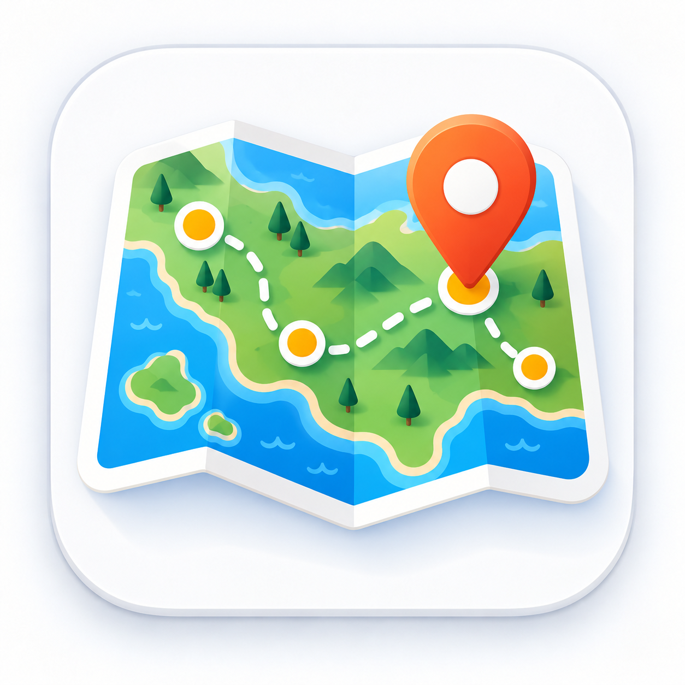

## Havassy András vibe kódolással létrehozott programjainak gyűjteménye 💻

<h1 align="center">Havassy András saját fejlesztésű alkalmazásai</h1>

Földrajztanárként olyan böngészőben használható alkalmazásokat készítek,
amelyek segítik a tanulást, a gyakorlást és a tanórai munkaszervezést.
Az itt bemutatott programok közül több közvetlenül kipróbálható online is.

 

<table>
  <tr>
    <td align="center" width="33%">
      <a href="https://havassy.github.io/ulesrend/">
         
        <b>Ülésrend-szervező</b>
      </a>
        
      Új ülésrend készítése a hiányzók és a csoportbeosztás figyelembevételével.
        
      <a href="https://havassy.github.io/ulesrend/">Kipróbálom</a> ·
      <a href="https://github.com/havassy/ulesrend">Repo</a>
    </td>
    <td align="center" width="33%">
      <a href="https://havassy.github.io/seterra/">
         
        <b>Seterra-ellenőrző</b>
      </a>
        
      Tanulói névsorok és Seterra-eredmények automatikus párosítása.
        
      <a href="https://havassy.github.io/seterra/">Kipróbálom</a> ·
      <a href="https://github.com/havassy/seterra">Repo</a>
    </td>
    <td align="center" width="33%">
      <a href="https://havassy.github.io/fotoblog/">
         
        <b>Napjaim a Balkánon</b>
      </a>
        
      Balkáni utazások fotónaplója – képek, helyszínek és rövid történetek.
        
      <a href="https://havassy.github.io/fotoblog/">Megnézem</a> ·
      <a href="https://github.com/havassy/fotoblog">Repo</a>
    </td>
  </tr>
  <tr>
    <td align="center" width="33%">
      <a href="https://havassy.github.io/fokhalozat3/">
         
        <b>Fokhálózat gyakorló</b>
      </a>
        
      Földrajzi koordináták és topográfiai helyek gyakorlása interaktív térképen.
        
      <a href="https://havassy.github.io/fokhalozat3/">Kipróbálom</a> ·
      <a href="https://github.com/havassy/fokhalozat3">Repo</a>
    </td>
    <td align="center" width="33%">
      <a href="https://havassy.github.io/szamoca/">
         
        <b>SZAMÓCA</b>
      </a>
        
      Csoportalkotó és szakértői mozaik szervező alkalmazás tanórai munkához.
        
      <a href="https://havassy.github.io/szamoca/">Kipróbálom</a> ·
      <a href="https://github.com/havassy/szamoca">Repo</a>
    </td>
    <td align="center" width="33%">
      <a href="https://havassy.github.io/terkepem/">
         
        <b>Térképem</b>
      </a>
        
      Saját helylistákkal használható térképes földrajzi kvíz és gyakorlófelület.
        
      <a href="https://havassy.github.io/terkepem/">Kipróbálom</a> ·
      <a href="https://github.com/havassy/terkepem">Repo</a>
    </td>
  </tr>
</table>

 

## Rólam

Földrajztanárként elsősorban olyan egyszerűen használható digitális eszközöket készítek,  
amelyek a tanítást, a gyakorlást és a tanórai szervezést segítik.

## További linkek

- 🌍 [Tanári blog / Substack](https://havassy.substack.com/)
- 📷 [Fotóblog](https://havassy.github.io/fotoblog/)
- 💻 [GitHub-profil](https://github.com/havassy)

<!--
**havassy/havassy** is a ✨ _special_ ✨ repository because its `README.md` (this file) appears on your GitHub profile.

Here are some ideas to get you started:

- 🔭 I’m currently working on ...
- 🌱 I’m currently learning ...
- 👯 I’m looking to collaborate on ...
- 🤔 I’m looking for help with ...
- 💬 Ask me about ...
- 📫 How to reach me: ...
- 😄 Pronouns: ...
- ⚡ Fun fact: ...
-->
